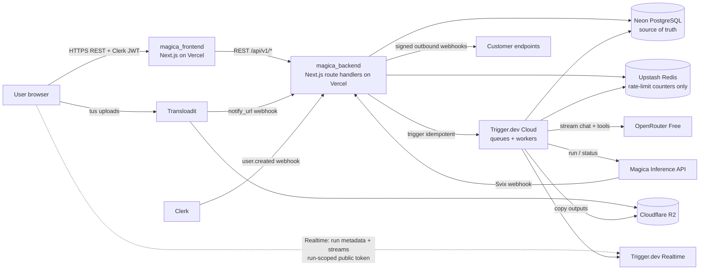
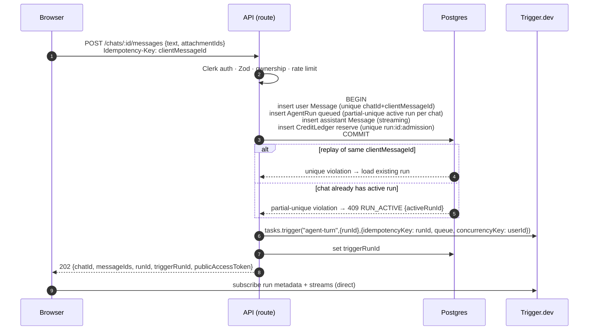
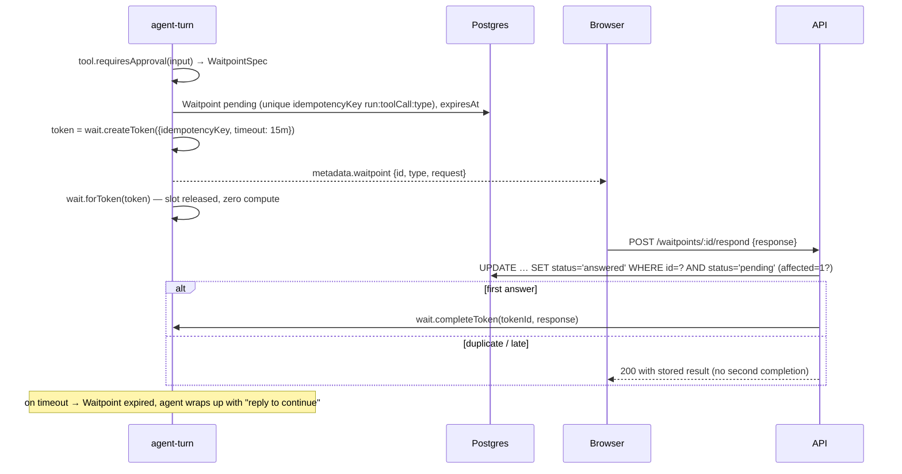

# ARCHITECTURE.md — High-Level Design

The system architecture for the Magica clone, designed so that **1,000 agent turns can run at the same time**,
alongside long conversations and 100+ tools and skills, without duplicate work or charges.

| | |
|---|---|
| Status | HLD v1 — 2026-10-17 |
| Scope | `magica_backend` (this repo) + `magica_frontend` |
| Related | `PRD.md` (product spec), `magica_frontend/DESIGN.md` (UI spec), `AGENTS.md` |

**Tags**
- **[Brief]** Required by the assignment PDF (quoted where it matters).
- **[Decision]** Our choice, recorded in §12.
- **[Pending]** Waiting on a reviewer's answer. The design has an interface seam so either answer fits.

---

## 1. Requirements that drive the architecture

| # | Requirement | Source |
|---|---|---|
| R1 | "The system must comfortably support long conversations and **1,000 concurrent agent turns**." | [Brief] |
| R2 | "Enforce **one active run per chat**, use **idempotent dispatch**, support resumable sessions, and handle **parallel tool calls without duplicating work or charges**." | [Brief] |
| R3 | "The REST request **starts durable work and returns quickly**; realtime is transport, while **PostgreSQL remains the durable source of truth**." | [Brief] |
| R4 | "Agent turns run in **durable Trigger.dev tasks**; long-running Magica work runs as **typed child tasks**." | [Brief] |
| R5 | "Reload or switch chats and **resume the active run from server-owned state**"; reconnect with bounded retries, token refresh, and REST fallback. | [Brief] |
| R6 | Waitpoints "pause safely, **resume exactly once**, tolerate duplicate submissions". | [Brief] |
| R7 | Scale-ready reads: **cursor pagination**, composite indexes, **no unbounded scans**. | [Brief] |
| R8 | Evaluated on: "Can this scale to **100 skills and tool types**, long conversations, and 1,000 concurrent agent turns?" | [Brief] |
| R9 | **No paid services**: OpenRouter Free with no fallback; Transloadit Community plan. | [Brief] |

---

## 2. Reality check: free tiers vs 1,000 concurrent turns

Researched 2026-10-17. Third-party sources disagree on some numbers; verify before quoting them externally.

| Dependency | Free-tier limit | Need at 1,000 concurrent turns | Consequence |
|---|---|---|---|
| Trigger.dev | 10–20 concurrent runs; 60 API req/min (Free) vs 1,500/min (paid) | ~1,000 *executing* slots at peak | Paid concurrency bundles needed in production |
| OpenRouter Free | 20 req/min per account; 50/day (1,000/day after a one-time $10 top-up) | ~10–15 LLM req/s (§9) | **The hard bottleneck.** Production needs a paid route behind the same `LlmProvider` |
| Magica API key | 60 req/min, 1,000/day by default (configurable to 10k/min) | ~3–8 req/s | Raise the key limits; we already use a webhook-first design |
| Neon Free | 0.25 CU, ~105 server connections; pooler takes 10k clients | ~300–500 writes/s, ~1k clients | Scale to 2–4 CU; the pooler absorbs the clients |

**Conclusion.**
- The architecture is **horizontally scalable to 1,000 concurrent turns on paid tiers without code changes**. Only configuration changes: concurrency limits, provider route and key limits.
- On free tiers it runs correctly at a small scale and degrades gracefully: work queues, a clear "busy" state, no failures.
- **[Pending: Slack Q1]** How we *demonstrate* 1,000. The proposal is a load-test harness that drives 1,000 concurrent turns using simulated LLM and Magica providers behind the same interfaces, with the results published (§10).

---

## 3. System context



---

## 4. Components & responsibilities

| Component | Runs on | Owns | Must not |
|---|---|---|---|
| **Web** (`magica_frontend`) | Vercel (static + RSC) | UI, TanStack Query cache, Zustand live buffers, realtime subscription | Hold business rules; call providers; redefine contracts |
| **API** (route handlers) | Vercel Functions (stateless) | Auth, Zod validation, ownership, rate limits, transactions (message + run + credit reserve), dispatch, realtime token minting, inbound webhooks, public API | Run agent logic; hold long connections; stream LLM output |
| **`agent-turn` task** | Trigger.dev worker | The agent loop for one turn: prompt assembly, LLM streaming, tool orchestration, block persistence, finalisation | Be non-idempotent; poll in short loops |
| **`magica-run` task** (child) | Trigger.dev worker | One Magica generation: estimate, reserve, POST, wait for webhook or reconcile, copy to R2, settle | Re-POST when a `magicaRunId` exists |
| **Cron tasks** | Trigger.dev schedules | Stale-run sweeper, re-dispatching undispatched runs, waitpoint expiry, purge, quota reset, webhook redelivery | — |
| **PostgreSQL** (Neon) | Managed | All durable state; uniqueness = idempotency; partial unique = run lock | Hold ephemeral token-stream chunks |
| **Trigger.dev Realtime** | Managed | Transport for run metadata (bounded) and the turn's AI SDK UI message stream (DEC-052; durable for 28 days, resumable) | Be the source of truth for settled turns |
| **Upstash Redis** | Managed | Ephemeral rate-limit counters (user sends and uploads, API keys, OpenRouter and Magica buckets) | Hold durable state, locks, idempotency or credits |
| **R2** | Cloudflare | Uploaded and generated media (permanent URLs) | — |
| **Contracts** (`@mohitbhalotia/magica-contracts`) | npm package | Every Zod schema across API, realtime, tools, webhooks and errors | — |

**Inside the backend (layering)**
Feature modules with one file per responsibility (`src/modules/<feature>/`). Full rules are in RULES.md §10.1.
```
route.ts ─► <x>.controller.ts ─► <x>.service.ts ─► <x>.repository.ts ─► Prisma ─► Postgres
 (wiring)   (HTTP: auth, Zod,      (rules, TX owner,   (Prisma only,
             DTO, withHandler)      idempotency,        optional tx,
                                    dispatch, credits)  ownership-scoped)
                                         │
                                         ├─► other modules' services (join TX via tx param)
                                         └─► providers/ (OpenRouter, Magica, Transloadit, R2) · Trigger.dev SDK

agentTurn.task ─► agent/ loop ─► LlmProvider (OpenRouter)       ─┐
                              ├─► tools/ registry ─► tool.execute ─┤─► services (persist, credits) ─► repositories
                              ├─► skills/ registry (load_skill)   │
                              └─► waitpoints/ registry           ─┘
contracts (Zod) at every edge: controllers, tasks, webhooks, providers, realtime
```

---

## 5. Key flows

### 5.1 Send a turn (fast path, R2/R3)


- **Latency budget:** p95 < 300 ms. One transaction (4 inserts), one Trigger API call, and token minting are local JWT work.
- **If the trigger call fails** after commit, the run stays `queued` with its `dispatchPayload`. The **re-dispatch cron** retries with the same idempotency key, so a duplicate execution is impossible.

### 5.2 Agent turn (one task per turn + child tasks) [Decision D1]

```mermaid
sequenceDiagram
  autonumber
  participant T as agent-turn
  participant DB as Postgres
  participant L as OpenRouter
  participant M as magica-run (child)
  participant RT as Realtime
  T->>DB: load run; exit if terminal (idempotent retry)
  T->>DB: restore session: window + rolling summary, RunSkill snapshots, completed ToolInvocations
  loop until final answer / waitpoint / guard
    T->>L: stream(messages, tools)  [AbortSignal]
    L-->>T: text/reasoning deltas
    T-->>RT: streams.text / streams.reasoning (append)
    T->>DB: persist completed block (block boundary only)
    L-->>T: tool calls (Zod-validated; repair ≤2)
    par independent tool calls
      T->>DB: upsert ToolInvocation (unique runId+toolCallId)
      T->>M: triggerAndWait({invocationId}, {idempotencyKey: invocationId})
      Note over T: parent checkpoints → concurrency slot released
    end
    M-->>T: typed result
    T->>DB: commit tool_result blocks in model-emitted order
    T-->>RT: metadata {status, step, toolStates, assetsReady}
  end
  T->>DB: finalise: assistant message terminal, usage, routedModel, settle/release credits
  T-->>RT: metadata status=completed
```
- **Guards:**
  - ≤ 12 LLM turns, ≤ N tool calls per turn, ≤ 15 min of wall clock.
  - A cancellation check before each LLM call and each tool.
- **Retries:** a crash replays the task. Completed blocks and invocations are read from the database and skipped. The in-progress text segment is recovered from the durable stream (§6).

### 5.3 Magica generation (webhook → waitpoint token, timed reconcile) [Decision D4]

```mermaid
sequenceDiagram
  autonumber
  participant M as magica-run
  participant DB as Postgres
  participant MG as Magica API
  participant A as API /webhooks/magica
  M->>DB: ToolInvocation pending; estimate (POST /nodes/estimate-credits)
  M->>DB: CreditLedger reserve (unique inv:id:reserve) — insufficient → fail INSUFFICIENT_CREDITS
  alt magicaRunId already set (retry)
    M->>M: skip POST
  else
    M->>M: token = wait.createToken({idempotencyKey: inv:id, timeout})
    M->>MG: POST /v1/nodes/{nodeType}/run {input, subModelId, webhook{url, metadata{invocationId, tokenId}}}
    MG-->>M: 202 {runId}
    M->>DB: persist magicaRunId (state running) — BEFORE waiting
  end
  loop until terminal or hard cap (~15 min)
    M->>M: wait.forToken(token, {timeout: 2m})  — slot released
    alt webhook arrived
      MG->>A: run.completed (Svix-signed)
      A->>DB: dedupe svix-id (ProviderWebhookEvent)
      A->>M: wait.completeToken(tokenId, payload)
    else timed out
      M->>MG: GET /v1/nodes/runs/{runId} (reconcile)
    end
  end
  M->>M: Zod-validate output → copy media to R2
  M->>DB: TX: Asset rows · ledger charge (unique inv:id:charge, actual creditUsed) · release remainder · invocation completed
```
- **Why not short polling:** per the Trigger.dev docs, `wait.for()` holds its concurrency slot for the first 60 s. Waitpoints and `triggerAndWait` release it. At 1,000 turns, short polls would pin ~1,000 slots doing nothing.
- **Magica rate limits:** the `magica-run` queue has its own concurrency cap sized to the key's limit. A 429 gets `Retry-After` handling, durable, up to 3 times.
- **Local development** can't receive webhooks without a tunnel. `MAGICA_WEBHOOKS=off` switches to reconcile-only mode, which has the same code path because the timeout branch is always present.

### 5.4 Human waitpoint (exactly once)



### 5.5 Reload / reconnect recovery (R5)

```mermaid
sequenceDiagram
  participant B as Browser
  participant A as API
  participant RT as Trigger Realtime
  B->>A: GET /chats/:id (messages page + activeRun)
  A-->>B: persisted blocks + activeRun{triggerRunId, status} + fresh publicAccessToken
  B->>RT: subscribe metadata; stream text from lastEventId (localStorage) or start
  RT-->>B: tail of in-progress segment + live deltas
  Note over B: merge by (messageId, blockIndex); persisted blocks win
  alt realtime fails
    B->>B: backoff ≤5 attempts → refresh token
    B->>A: fallback poll GET /runs/:id every 2s until realtime recovers
  end
  B->>A: on terminal status → invalidate queries → render persisted message
```

---

## 6. Data & state management

### 6.1 Source of truth
- **Postgres holds everything settled:** chats, messages with ordered content blocks, runs, tool invocations, skills loaded, waitpoints, attachments, assets, the credit ledger and webhook deliveries. The full model is in PRD §7.
- **The Trigger.dev stream holds the in-flight text segment only.** It is durable for 28 days and resumable via `lastEventId`. [Decision D2]
- **Run metadata** is a bounded projection for the UI: status, step count, tool states, waitpoint, ready assets. It is always rebuildable from Postgres.

### 6.2 Write strategy while streaming [Decision D2]
| Event | Write |
|---|---|
| Text segment completes (tool call starts, or turn ends) | Append a `text` block |
| Tool call emitted | Upsert `ToolInvocation` + `tool_use` block |
| Tool result | Update invocation + `tool_result` / `asset_ref` blocks (in model order) |
| Turn terminal | Message status, usage, credits (single transaction) |
| Task crash → retry | Recover the partial segment by reading the run's own UI message stream, then continue |
| Terminal failure | `onFailure` writes the partial text plus a failed status, so the brief's "preserve streamed text" is met |

This works out to **≈ 0.2 DB writes/s per active run**, versus ~20–50/s if we wrote every token.

### 6.3 Idempotency map (R2)
| Side effect | Key (DB unique or Trigger idempotency) |
|---|---|
| User message | `(chatId, clientMessageId)` |
| Active run lock | partial unique `AgentRun(chatId) WHERE status IN active` |
| Dispatch turn | Trigger `idempotencyKey = runId` |
| Tool invocation | `(runId, toolCallId)` |
| Magica child task | Trigger `idempotencyKey = invocationId` |
| Magica run creation | `ToolInvocation.magicaRunId` set ⇒ never re-POST |
| Credit reserve / charge / release | `run:{id}:admission`, `inv:{id}:reserve`, `inv:{id}:charge`, `inv:{id}:release` |
| Waitpoint create / answer | `run:toolCall:type`; conditional `pending → answered` |
| Inbound webhooks | `ProviderWebhookEvent(id = svix-id / assembly_id / clerk svix-id)` |
| Outbound webhooks | `(endpointId, eventId)` |
| Skill load | `RunSkill(runId, skillName)` + content hash |

### 6.4 Indexing for scale-ready reads (R7)
- Chats list: `(userId, isPinned DESC, updatedAt DESC, id DESC)`, with a keyset cursor over the same tuple.
- Messages: `(chatId, createdAt DESC, id DESC)`. Newest first, with a `before` cursor.
- Search: case-insensitive substring match (`ILIKE`) on `Chat.title` (served by the `pg_trgm` GIN index) and `Message.text`, scoped to the user's non-deleted chats (DEC-049).
- Sweeper: `AgentRun(status, updatedAt)`. Ledger: `(userId, createdAt, id)`.
- Every list has `limit ≤ 50`. No `OFFSET`, no `COUNT(*)` on hot paths.

---

## 7. Concurrency, fairness & backpressure

### 7.1 Queues (Trigger.dev) [Decision D3]
| Queue | Concurrency key | Limit | Purpose |
|---|---|---|---|
| `agent-turn` | `userId` | **3 per user**; global = environment limit | Fairness: one user can't take the whole pool. A fourth turn shows "Queued". |
| `magica-run` | — | sized to the Magica key limit (e.g. 50) | Protects the Magica key from 429 storms |
| `title`, `summary`, `webhook-delivery` | — | small (5–20) | Background work never starves turns |

- **Slots are only held while executing.** `triggerAndWait` and `wait.forToken` checkpoint and release them. Turns waiting on a generation or a human therefore cost **no** slots.
- One active run per chat is enforced in Postgres, not by queues. It holds even if Trigger.dev retries.

### 7.2 Global provider throttling
- **OpenRouter:** each account has a requests-per-minute cap. A shared **token bucket** gates each LLM call; when it's empty the task backs off durably. Within 60 s it holds the slot; past 60 s it releases it.
- **Where the bucket lives [Decision D9, approved by reviewers]:** **Upstash Redis** via `@upstash/ratelimit` (sliding window and token bucket), behind a `RateLimiter` interface.
- **User-facing rate limits** (sends and uploads per user, public-API keys) use the same `RateLimiter` interface.
- **Scope rule:** Redis holds **only ephemeral rate-limit counters**. It never holds durable or business state such as runs, locks, idempotency, credits or messages. Those stay in Postgres.
  - If Redis is unreachable, the limiter **fails open** for user limits and **fails closed** (backoff) for provider buckets, and logs a warning. Correctness never depends on Redis.

### 7.3 Backpressure behaviour (graceful at any scale)
| Pressure | Behaviour |
|---|---|
| Pool saturated | Turns wait in the queue; the UI shows "Queued". The API stays fast because it only enqueues. |
| OpenRouter 429 / exhausted | Durable backoff ≤ 3. Then a terminal `MODEL_UNAVAILABLE` with retry guidance; partial output is kept. |
| Magica 429 | Queue cap plus `Retry-After`. The tool shows "running" until the call is accepted. |
| DB pressure | Pooled connections; block-boundary writes; batched metadata updates |
| Stale lock (run died) | The sweeper (every 1 min) checks the Trigger run status, marks the run `failed(STALE)` and frees the chat |

---

## 8. Long conversations & extensibility

### 8.1 Context window [Decision D5]
- The prompt is the system prompt, the skill index (names and descriptions only), tool schemas from the registry, a **rolling summary** of older turns, the **last N turns verbatim**, and the current input.
- The summary is refreshed every K turns by a background `summary` task (cheap OpenRouter Free call), stored on `Chat`, and versioned.
- Tool outputs and assets enter the prompt as **ID references** (`asset_ref`, short previews), never as raw blobs.
- The UI reads messages via cursor pages; the virtualised list keeps very long chats at 60 fps.

### 8.2 Scaling to 100+ tools and skills (R8)
- **Tools:** one `defineTool` file each. The registry derives LLM tool schemas, Zod validation, credit estimation, approval policy and the renderer `kind`.
  - **Tool count vs context:** if more than ~20 tools would bloat the prompt, the registry exposes only always-on tools plus `search_models` / `get_model_schema`. This matches the reference's discovery pattern; the model finds models on demand.
- **Skills:** a folder per skill; the registry is built at startup and only the index goes in the prompt. Loading is O(1) per request, with bodies cached in memory by hash.
- **Waitpoint types and renderers:** registries keyed by type. Zero orchestration branches.

---

## 9. Capacity model (1,000 concurrent turns, paid tiers)

These are the numbers we size against. We replace them with measured values once the load test runs.

| Assumption | Value |
|---|---|
| A turn | 6 LLM calls × ~8 s streaming, 1.5 Magica generations × ~20 s, ≈ 90 s total |
| Fraction of turn time actively executing (LLM streaming + tool CPU) | ~55% |
| Fraction waiting (Magica, human) | ~45% (slots released) |

| Resource | Estimate at 1,000 concurrent turns |
|---|---|
| Executing Trigger.dev slots | ~550 typical, 1,000 worst case → configure the environment limit to 1,000 |
| LLM requests in flight | ~550 streaming; ~6.7 new LLM req/s |
| Magica | ~17 runs/min created; ~1,000 webhooks/min worst case |
| Postgres writes | ~0.2 block writes/s × 1,000 + invocation, ledger and metadata ≈ **300–500 writes/s** → Neon 2–4 CU |
| Postgres connections | Each worker uses a Prisma pool of `connection_limit=1–2` via the **pooled** endpoint (≤10k clients) → ~100–200 server connections |
| API (Vercel) | Sends are short; realtime is browser ↔ Trigger directly, so **zero** long-lived backend connections |
| Realtime | 1,000 runs × (metadata + 2 streams); metadata updates batched to ≤ 2/s per run |
| Trigger API calls | 1,000 triggers + token completions per burst → paid tier (1,500 req/min); use `batchTrigger` for bulk |

**Bottleneck ranking:**
1. LLM provider throughput: free tier ≈ 0.33 req/s vs ~6.7 needed.
2. Trigger.dev concurrency (plan).
3. Magica key limit.
4. Postgres write IOPS.

The first three are configuration and plan changes only. No code changes.

---

## 10. Verifying scale — [Pending: Slack Q1]
**Proposed:**
- `load/` contains a k6 (or Node) script and a `SIMULATED_PROVIDERS=true` environment that swaps `LlmProvider` and the Magica client for simulators.
- The simulators keep the same interfaces with cancellation-aware, configurable latency, token rates and failure injection (429s, timeouts, empty streams, malformed tool calls).
- Everything else is real: API, Postgres, Trigger.dev queues, realtime, idempotency, credits.
- The run fires 1,000 turns across 300 users and records: p95 send latency, time to first token, completion rate, duplicate charges (must be 0), duplicate messages (must be 0), stale locks, DB CPU and connections, slot utilisation.
- Results are published in §9 and the README.
- **Simulators exist only in the load-test environment.** Production never stubs OpenRouter or Magica [Brief].

---

## 11. Reliability & failure modes

| Failure | Detection | Recovery |
|---|---|---|
| API crashes after commit, before trigger | Run `queued` with no `triggerRunId` > 30 s | Re-dispatch cron (same idempotency key) |
| Worker crash mid-turn | Trigger.dev retry | Replay: skip persisted blocks and completed invocations; recover the partial text from the stream |
| Duplicate send (double click, retry) | Unique `clientMessageId` | Return the existing run |
| Concurrent send on the same chat | Partial unique index | `409 RUN_ACTIVE` plus the active run ID; the UI attaches to it |
| Magica webhook lost | `wait.forToken` timeout | Reconcile GET; hard cap → `GENERATION_TIMEOUT` |
| Magica webhook duplicated | `svix-id` dedupe | No-op |
| Late Magica result after cancel | Invocation `cancelled` | Ignore the output; **still settle the actual charge** (truthful ledger) |
| User clicks Stop | `POST /runs/:id/cancel` → status `stopping` + `runs.cancel` | Abort signal → partial output kept → `cancelled`; only completed work is charged |
| Waitpoint unanswered | Token timeout | `expired`; the agent explains how to continue; the UI clears the overlay from server state |
| Mid-turn credit exhaustion | Reserve fails | Stop billable tools, settle completed ones, finish with a notice |
| Realtime outage | Client backoff | Token refresh, then REST polling; the database is authoritative |
| Stale active lock | Sweeper | Mark `failed(STALE)`, release the chat |

**Observability:**
- pino JSON logs with `chatId, runId, messageId, traceId, processId (=Trigger run id), waitpointTokenId`.
- The trace ID is returned in every error envelope and shown in the UI.
- Trigger.dev tags: `chat_*`, `user_*`.
- Health checks: `GET /api/v1/health` and `GET /api/v1/models/status`.

---

## 12. Decision log
> Full rationale for every decision (context, why, alternatives, consequences) is in `DECISIONS.md` at the workspace root. D1–D10 map to DEC-010 to DEC-016, DEC-006 (D9) and DEC-022 (D10).


| ID | Decision | Status | Alternatives rejected |
|---|---|---|---|
| D1 | One `agent-turn` task per turn; Magica work as `magica-run` child tasks via `triggerAndWait` | Accepted | A task per LLM step: finer recovery, but many more runs and more orchestration code |
| D2 | Persist at **block boundaries only**; the in-flight segment lives in Trigger.dev's durable stream (28-day retention, `lastEventId` resume); `onFailure` persists partial text | Accepted (backed by Trigger.dev docs) | ~1 s timed flush (5× writes); per-delta writes (not viable at 1k) |
| D3 | Per-user concurrency of **3 turns** (`concurrencyKey=userId`); one active run per chat in Postgres | Accepted | 1 per user (too strict); unlimited (no fairness) |
| D4 | Magica: **webhook → waitpoint token**, with 2-minute timed reconcile and a ~15-minute hard cap | Accepted | Long-interval polling (≥ 90 s latency) |
| D5 | Context = **window + rolling summary**; assets by reference | Accepted | Token-budget truncation (forgets early context) |
| D6 | Browser subscribes **directly** to Trigger.dev Realtime with a run-scoped token; REST polling fallback | Accepted | Backend SSE proxy (long-lived serverless connections) |
| D7 | **Neon** Postgres with the pooled endpoint; Prisma `connection_limit` 1–2 per worker | Accepted | Supabase (unused extras), self-hosted |
| D8 | ARCHITECTURE.md lives in `magica_backend` | Accepted | — |
| D9 | Global (provider) and user rate limiting via **Upstash Redis** (`@upstash/ratelimit`) behind a `RateLimiter` interface; Redis holds only ephemeral counters | Accepted (reviewer-approved 2026-10-17) | Postgres row-lock bucket (adds hot-row contention at 1k turns) |
| D10 | Scale proof via a load-test harness with simulated providers | **Pending (Slack Q1)** | Capacity math only |

---

## 13. Open questions
1. **[Slack Q1]** How should 1,000-turn scale be demonstrated? Will higher-tier accounts be provided?
2. ~~Is Redis (Upstash) acceptable?~~ **Resolved:** yes, for rate-limit counters (D9).
3. Does Magica offer run cancellation? It isn't documented; we assume none.
4. Confirm the current Trigger.dev Free concurrency (10 or 20) and that `wait.forToken` checkpoints immediately, as `triggerAndWait` does. Verify in the dev environment.
