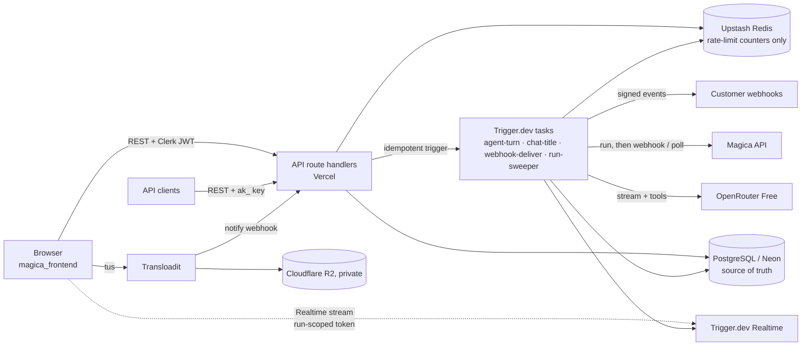

# Magica Agent Chat: backend

The API, agent runtime and data layer for a production-grade clone of Magica's agent chat. Next.js route handlers on Vercel, durable agent turns on Trigger.dev, PostgreSQL (Neon) through Prisma, and a public REST API with signed webhooks.

| | |
|---|---|
| **App** | https://magica-galaxy-frontend.vercel.app (frontend repo: `magica_frontend`) |
| **API** | https://magica-galaxy-backend.vercel.app/api/v1 |
| **API docs** | https://magica-ebc2eaac.mintlify.site |

## What it does

- **Chat.** Every message starts an agent **run**: a durable Trigger.dev task that streams the reply over Trigger.dev Realtime and saves it in Postgres. Reload mid-reply and you see the same stream; Stop keeps the partial answer; failed and stopped replies can be retried.
- **Free model only.** The LLM is OpenRouter Free (`openrouter/free`), through the Vercel AI SDK, with no paid fallback.
- **Real Magica tools.** The agent picks `crop_image`, `gpt_image_2` (new images or edits) and `merge_videos` from intent, and can chain them. Calls go to the real Magica API, never stubs, with discovery tools (`search_models`, `get_model_schema`) and four skills loaded on demand.
- **Credits.** Each user has a micro-credit ledger with a seed grant. A tool's cost is reserved, then charged or released, each exactly once. Costs above 0.05 credits, or ones Magica can't estimate, pause the run for the user's approval.
- **Waitpoints.** The agent can ask the user to approve a cost, pick an option, or approve a plan. The run waits on a Trigger.dev token at no compute cost and resumes exactly once.
- **Uploads.** Uppy uploads through Transloadit (tus) into a private Cloudflare R2 bucket. Attachments reach the agent as short-lived signed links.
- **Public API.** API keys, an OpenAI-compatible `/chat/completions` (stream and non-stream), direct tool runs, and signed outbound webhooks (Standard Webhooks). Documented on Mintlify, with the reference generated from the same schemas the API validates with.
- **Recovery.** A cron sweeper re-dispatches runs whose dispatch was lost and settles runs whose worker died. The browser falls back to polling when Realtime drops.

## Architecture



- **Postgres is the source of truth.** Realtime only carries the live stream; the UI always settles on what the database says.
- **The API never runs agent logic.** It validates, checks ownership, writes the message, run and credit reserve in one transaction, triggers the task with an idempotency key, and returns in milliseconds.
- **One `agent-turn` task per reply.** It runs the AI SDK tool loop (at most 8 steps), streams AI SDK UI chunks to Realtime, and settles the turn in one transaction:
  - the message and its blocks;
  - the run status;
  - the credits, and the release of the admission reserve;
  - the webhook outbox.
- **Magica runs don't busy-wait.** Each one is created once: its id is saved before any wait, so a retry never pays twice. The task then waits on a Trigger.dev token whose URL is Magica's webhook, and re-reads the result with our own key. If the webhook is late, it polls every 30s up to a 15-minute cap.

Code layout (feature modules, one file per job):

```
src/app/api/v1/**/route.ts   wiring only
src/modules/<feature>/       controller (HTTP, Zod) → service (rules, transactions) → repository (Prisma)
src/agent/                   turn loop, tools (defineTool registry), skills, title
src/trigger/                 Trigger.dev tasks
src/providers/               OpenRouter, Magica, Transloadit, R2, the direct-tool model
packages/contracts/          every Zod schema, published as @mohitbhalotia/magica-contracts
agent-skills/<name>/SKILL.md skills, loaded by the model on demand
docs/                        Mintlify site; openapi.json is generated
prisma/                      schema + migrations (each with forward / rollback / compat notes)
```

The full design is in [ARCHITECTURE.md](ARCHITECTURE.md): flows, the idempotency map, the capacity model for 1,000 concurrent turns, and the failure modes. Every decision, with its reasons, is in [`../DECISIONS.md`](../DECISIONS.md) in the workspace (DEC-001 onwards).

## Design decisions and trade-offs

- **Contracts as a published package.** The frontend imports every request, response, realtime and webhook shape from `@mohitbhalotia/magica-contracts` and never redefines one. Zod validates at every trust boundary, and the OpenAPI file is generated from the same schemas. The cost: a contract change means publishing a version before the frontend can use it.
- **Exactly-once by database keys, not locks.** These each have a unique key or a conditional update:
  - dispatch (`dispatchKey`), the tool call (`runId`, `toolCallId`), the Magica run id;
  - ledger entries, waitpoint answers;
  - inbound Transloadit notifications and webhook deliveries.

  One active run per chat is a partial unique index. Retries are safe everywhere.
- **The AI SDK message is the storage format.** Saved content blocks are the SDK's UI parts, so the live view and the saved view render the same way, with no translation layer. The trade-off: a breaking SDK change could need a data migration.
- **Direct tool runs reuse the agent path.** `POST /tools/{tool}/run` gives the turn a stand-in "model" that asks for exactly one tool call. Credits, approvals, persistence, Stop and the sweeper all apply with no second implementation.
- **The webhook outbox is written in the same transaction as the change.** An event exists exactly when the change it reports does. Delivery is a retried task, plus a sweeper for tasks that never started.
- **Redis holds only rate-limit counters.** Never state, locks, idempotency or credits, so losing Redis loses nothing.
- **Known limits:**
  - **Crash re-entry:** a worker crash mid-turn fails the turn rather than resuming it. The sweeper frees the chat.
  - **Stop during a Magica generation:** it charges 0 even if Magica finishes and bills (DEC-057).
  - **Generated media:** it stays on Magica's CDN and isn't copied to R2.
  - **Long chats:** the model sees the last 20 messages, with no rolling summary.

## Running it locally

Requirements: Node 24+, pnpm 12, and accounts for Clerk, Neon, Trigger.dev, Upstash, OpenRouter, Transloadit, Cloudflare R2 and Magica. Every service used has a free tier.

```bash
pnpm install
cp .env.example .env.local      # fill in every value (see the comments in the file)
pnpm db:deploy                  # apply migrations to your Neon database
pnpm dev                        # API on http://localhost:4000
pnpm trigger:dev                # the Trigger.dev worker, in a second terminal
```

The frontend (`magica_frontend`) points at the API through `NEXT_PUBLIC_API_BASE_URL`.

| Command | |
|---|---|
| `pnpm typecheck` · `pnpm lint` · `pnpm format:check` | Static checks |
| `pnpm test` | Unit tests |
| `pnpm test:int` | Integration tests on a throwaway Neon branch (needs `NEON_API_KEY`, `NEON_PROJECT_ID`) |
| `pnpm test:coverage` | Everything, with the coverage gates CI enforces |
| `pnpm openapi` | Regenerate `docs/openapi.json` from the contracts (`openapi:check` in CI) |
| `pnpm docs:dev` | Preview the Mintlify docs |
| `pnpm contracts:publish` | Build and publish the contracts package (from merged `main` only) |

CI (GitHub Actions) runs every check on every PR. On `main` it then applies migrations, deploys the Trigger.dev tasks and deploys the API to Vercel, in that order.

## With more time

- **Load test.** Prove the 1,000-concurrent-turn capacity model with simulated LLM and Magica providers behind the same interfaces (ARCHITECTURE §9–10).
- **Crash re-entry.** Resume a turn from its last persisted step after a worker crash, instead of failing it.
- **Settle Stop billing truthfully.** A background task that reads the Magica run after Stop and charges what it actually cost.
- **Copy generated media to R2,** so assets outlive Magica's CDN retention.
- **Long chats.** A rolling summary, so the model sees the whole conversation.
- **API keys.** Per-key scopes and an MCP server over the same API.
- **More tests.** Visual regression against the reference, and live provider tests on a schedule.
